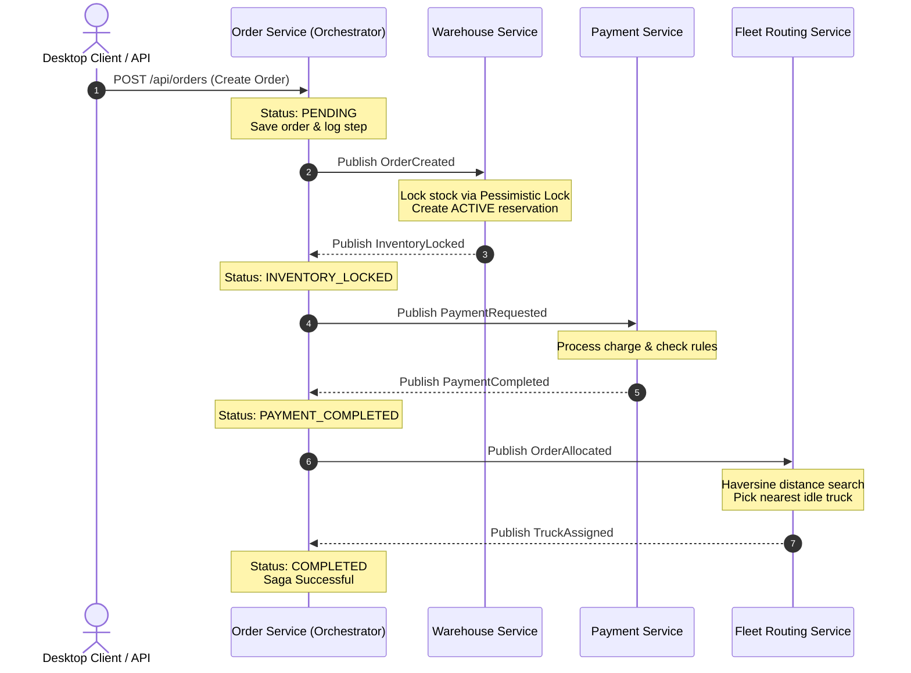
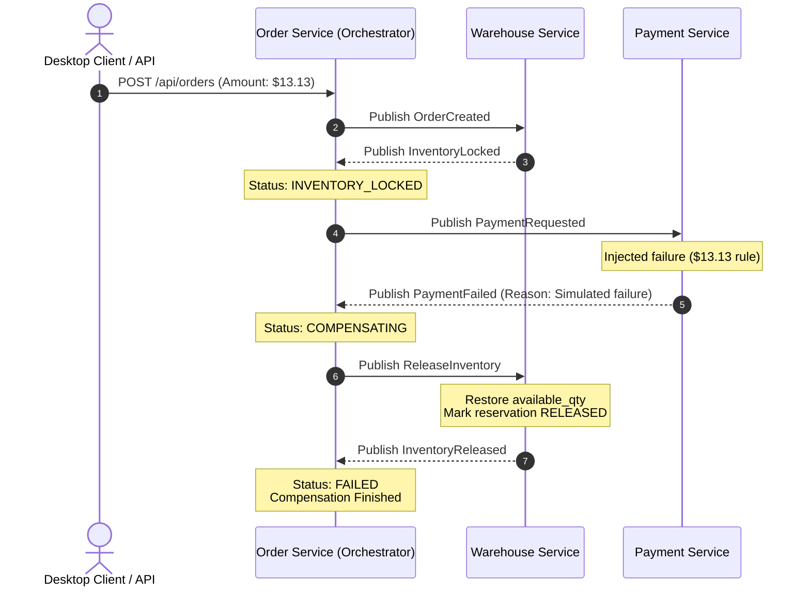
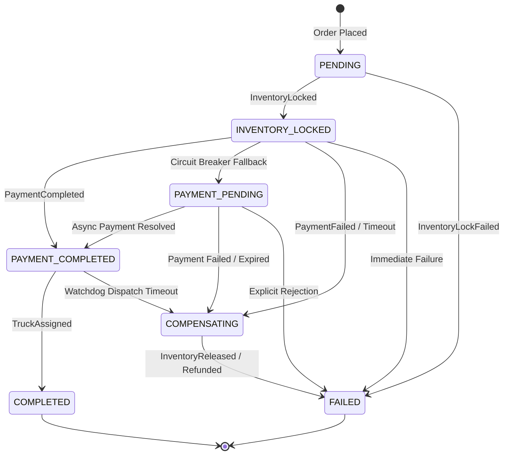

# OmniRoute: Event-Driven Distributed Order Fulfillment & Fleet Routing

OmniRoute is an event-driven, microservices-based logistics and order fulfillment platform built with **Java 21**, **Spring Boot 3.3**, **Apache Kafka (KRaft)**, **PostgreSQL 16**, and a real-time **JavaFX 21** desktop client. It coordinates distributed transactions via the **Saga Pattern (Orchestration)**, incorporates automated compensations and watchdogs, and dynamically assigns vehicles using real-time GPS telemetry and Haversine geodesic routing.

---

## 1. System Architecture

```mermaid
flowchart TD
    subgraph ClientLayer["Presentation & Client Layer"]
        UI["JavaFX Desktop Client (Port 8080 Target)"]
        CLI["Demo Load Scripts (demo.sh / demo.ps1)"]
    end

    subgraph GatewayLayer["API Gateway (Port 8080)"]
        GW["Spring Cloud Gateway\n(CORS, Path Rewriting, Resilience)"]
    end

    subgraph Microservices["Backend Services"]
        OS["Order Service\n(Port 8081)\nSaga Orchestrator & State Machine"]
        WS["Warehouse Service\n(Port 8083)\nPessimistic Locking & Reservations"]
        PS["Payment Service\n(Port 8082)\nFailure Simulation & Authorizations"]
        FS["Fleet Routing Service\n(Port 8084)\nGeodesic Engine & In-memory Tracking"]
        TS["Telemetry Simulator\n(Port 8085)\n200 GPS Virtual Threads"]
    end

    subgraph Messaging["Kafka Event Bus (KRaft)"]
        TOPIC_ORDERS["omniroute.orders.events"]
        TOPIC_PAY_CMD["omniroute.payment.commands"]
        TOPIC_PAY_EVT["omniroute.payment.events"]
        TOPIC_WH_CMD["omniroute.warehouse.commands"]
        TOPIC_WH_EVT["omniroute.warehouse.events"]
        TOPIC_FLEET_GPS["omniroute.fleet.gps"]
    end

    subgraph Storage["PostgreSQL Multi-Database"]
        DB_ORDERS[("orders_db")]
        DB_PAY[("payments_db")]
        DB_WH[("warehouse_db")]
    end

    UI -->|REST /api/**| GW
    CLI -->|REST /api/**| GW

    GW -->|/orders/**| OS
    GW -->|/inventory/**| WS
    GW -->|/fleet/**| FS

    OS -->|JDBC / Flyway| DB_ORDERS
    PS -->|JDBC / Flyway| DB_PAY
    WS -->|JDBC / Flyway| DB_WH

    OS -->|OrderCreated, OrderAllocated| TOPIC_ORDERS
    OS -->|PaymentRequested, RefundPayment| TOPIC_PAY_CMD
    OS -->|ReleaseInventory| TOPIC_WH_CMD

    WS -->|InventoryLocked, InventoryLockFailed, InventoryReleased| TOPIC_WH_EVT
    PS -->|PaymentCompleted, PaymentFailed, PaymentRefunded| TOPIC_PAY_EVT
    TS -->|TruckPositionUpdated (500ms)| TOPIC_FLEET_GPS
    FS -->|TruckAssigned| TOPIC_ORDERS

    TOPIC_ORDERS --> OS
    TOPIC_WH_EVT --> OS
    TOPIC_PAY_EVT --> OS
    TOPIC_FLEET_GPS --> FS
```

---

## 2. Kafka Topic Reference

| Topic Name | Producer(s) | Consumer(s) | Payload Events | Purpose |
|---|---|---|---|---|
| `omniroute.orders.events` | `order-service`, `fleet-routing` | `warehouse-service`, `fleet-routing`, `order-service` | `OrderCreated`, `OrderAllocated`, `TruckAssigned` | Saga initialization, dispatch trigger, and finalization |
| `omniroute.warehouse.commands` | `order-service` | `warehouse-service` | `ReleaseInventory` | Compensation command to release reserved stock |
| `omniroute.warehouse.events` | `warehouse-service` | `order-service` | `InventoryLocked`, `InventoryLockFailed`, `InventoryReleased` | Inventory reservation and release confirmations |
| `omniroute.payment.commands` | `order-service` | `payment-service` | `PaymentRequested`, `RefundPayment` | Payment authorization & refund requests |
| `omniroute.payment.events` | `payment-service` | `order-service` | `PaymentCompleted`, `PaymentFailed`, `PaymentRefunded` | Payment status updates and failure notices |
| `omniroute.fleet.gps` | `telemetry-simulator` | `fleet-routing`, `fleet-routing-streams` | `TruckPositionUpdated` | High-throughput GPS updates (up to 10,000+ events/sec) |

Saga event topics are configured with **3 partitions**, and `omniroute.fleet.gps` is configured with **12 partitions** for high-throughput parallel ingestion, consumer-group horizontal scaling, and Streams task distribution. All topics have replication factor 1 and Dead Letter Topics (`<topic>.DLT`).

---

## 3. Distributed Saga Flows

### A. Happy Path Workflow (Order Completion)



### B. Failure & Compensation Workflow (e.g., Payment Failure or $13.13 trigger)



---

## 4. Order State Machine



### State Transition Validation Table

| Current State | Allowed Next States | Trigger Event |
|---|---|---|
| `PENDING` | `INVENTORY_LOCKED`, `FAILED` | `InventoryLocked`, `InventoryLockFailed` |
| `INVENTORY_LOCKED` | `PAYMENT_COMPLETED`, `PAYMENT_PENDING`, `COMPENSATING`, `FAILED` | `PaymentCompleted`, Circuit breaker open, `PaymentFailed` |
| `PAYMENT_PENDING` | `PAYMENT_COMPLETED`, `COMPENSATING`, `FAILED` | Payment resolution or fallback timeout |
| `PAYMENT_COMPLETED` | `COMPLETED`, `COMPENSATING`, `FAILED` | `TruckAssigned`, or fleet dispatch timeout |
| `COMPENSATING` | `FAILED` | `InventoryReleased`, `PaymentRefunded` |
| `COMPLETED` | *Terminal State (None)* | N/A |
| `FAILED` | *Terminal State (None)* | N/A |

---

## 5. Architectural & Design Decisions

### 1. Why the Saga Pattern?
In a distributed microservice architecture, multi-database transactions across PostgreSQL instances cannot rely on two-phase commit (2PC) without introducing severe performance bottlenecks, blocking locks, and single-points-of-failure. The Saga pattern provides **eventual consistency** by breaking transactions into localized sub-transactions paired with explicit compensating actions.

### 2. Why Orchestration over Choreography?
* **Single Source of Truth**: The `order-service` functions as the Saga Orchestrator, maintaining a complete state machine and an immutable `saga_log` of every transition and event ID.
* **Inspectability & Monitoring**: Sagas can be inspected via REST APIs in real time, enabling the desktop UI to display granular timelines.
* **Reduced Cyclomatic Coupling**: Services only need to know how to perform their specific domain tasks and reply with standard events, preventing circular event cascades.

### 3. Idempotency & Exactly-Once Semantics
Network retries and Kafka consumer rebalances inevitably deliver duplicate messages. To guarantee safety:
* Every service checks incoming `eventId` against a dedicated `processed_events` table within the same ACID transaction before taking action.
* Duplicate events are logged as warnings and safely skipped without re-decrementing stock, charging payments, or re-running dispatches.

### 4. Transaction Order vs. Transactional Outbox
Currently, services commit the local DB transaction first, and then publish to Kafka. If the process terminates in the microsecond between DB commit and Kafka dispatch, the event could be lost.
* **Current Mitigation**: The `OrderWatchdogService` periodically audits orders stuck in transitional states (`INVENTORY_LOCKED`, `PAYMENT_COMPLETED`) beyond a threshold and initiates recovery.
* **Production Recommendation**: The **Transactional Outbox Pattern** with Debezium CDC (Change Data Capture) will be the future enhancement to make DB commits and message publication atomic.

### 5. High-Throughput Spatial Routing: Classic vs. Kafka Streams Engine
OmniRoute features two interchangeable vehicle dispatch engines:
* **Classic Engine (`fleet-routing`)**: In-memory `ConcurrentHashMap` cache populated by Spring Kafka consumer listeners with linear O(N) distance scans.
* **Streams Engine (`fleet-routing-streams`)**: Distributed, fault-tolerant topology leveraging **Kafka Streams**, **RocksDB state stores**, and **Chebyshev spatial grid partitioning**:
  * **Geodesic Cell Indexing**: Telemetry is indexed into discrete geo-spatial cells (~5.5 km resolution, `c_latIdx_lonIdx`).
  * **Concentric Chebyshev Rings**: When an `OrderAllocated` event occurs, the processor expands radial rings (`ring 0, 1, ..., maxRings`) outward from the warehouse coordinate, calculating exact Haversine distance only for vehicles in candidate cells.
  * **Tumbling Window Aggregations**: Maintains 30-second windowed counts of telemetry updates per cell to measure traffic density.
  * **Exactly-Once Semantics (`processing.guarantee: exactly_once_v2`)**: Guarantees atomic state updates and dispatch event generation.
### 6. High-Throughput Telemetry (10,000+ Events/Sec) & Client-Side Sampling
To stress test the system under industrial-scale telemetry loads:
* **Configurable Virtual-Thread Generation**: The `telemetry-simulator` scales vehicle count (`TRUCK_COUNT`) and emission frequency (`EMIT_INTERVAL_MS`). With 5,000 trucks at 500ms (or 2,000 trucks at 200ms), it sustains **10,000+ events per second**.
* **Producer Batching & Compression**: Tuned for high throughput using LZ4 block compression (`compression-type: lz4`), 128KB batch sizes (`batch.size: 131072`), 20ms linger (`linger.ms: 20`), and `acks=1` for telemetry events.
* **12-Partition Ingestion & Horizontal Scaling**: `omniroute.fleet.gps` is partitioned across 12 Kafka partitions with 4 concurrent listener threads per routing instance, supporting multi-container scaling via `fleet-routing-replica` (`--profile scale`).
* **Server-Side UI Protection & Sampling**: To keep the JavaFX radar running at a fluid 60 FPS under massive event floods, the routing API samples and bounds returned trucks (`max-returned-trucks: 300`):
  1. **All Active Dispatches Retained**: Vehicles with active delivery assignments are unconditionally returned with their routing lines.
  2. **Nearest-to-Hub Filtering**: Remaining slots are filled with the closest available trucks relative to the central distribution hub.

---

## 6. How to Run

### Prerequisites
* **Java 21** (JDK 21+)
* **Maven 3.9+**
* **Docker Desktop** (or Docker Engine + Compose)

### A. Start the Entire Backend with Docker Compose
From the `omniroute` folder:
```powershell
cd omniroute
docker compose up --build
```
This launches:
* **Kafka** (`localhost:29092` host, `kafka:9092` internal)
* **Kafka UI** (`http://localhost:8090`)
* **PostgreSQL** (`localhost:5432`) with `orders_db`, `payments_db`, `warehouse_db`
* **Order Service** (`http://localhost:8081`)
* **Payment Service** (`http://localhost:8082`)
* **Warehouse Service** (`http://localhost:8083`)
* **Fleet Routing Service** (`http://localhost:8084` - Classic Engine)
* **Telemetry Simulator** (`http://localhost:8085` generating 200 trucks)
* **API Gateway** (`http://localhost:8080`)
* **Jaeger Tracing** (`http://localhost:16686`)
* **Prometheus** (`http://localhost:9090`)
* **Grafana Dashboards** (`http://localhost:3000` - admin/admin)

#### Running with Kafka Streams Spatial Routing Engine:
To start the Kafka Streams spatial windowing engine alongside the cluster:
```powershell
docker compose --profile streams up --build
```
The streams engine runs on port `8086` (`http://localhost:8086/actuator/health`, `http://localhost:8086/fleet/cells`) with RocksDB persistent state in docker volume `streams_data`.

#### Running High-Throughput Telemetry (10,000+ eps) & Horizontally Scaled Routing:
```powershell
$env:TRUCK_COUNT="5000"; $env:EMIT_INTERVAL_MS="500"; docker compose --profile scale up --build -d
```
To verify telemetry throughput and radar latency:
```powershell
.\omniroute\scripts\verify-throughput.ps1
```

### B. Launch the JavaFX Desktop Client
The desktop client runs on the host machine and communicates directly with the Gateway:
```powershell
cd omniroute
mvn -pl desktop-client javafx:run
```
* **Orders Tab**: Real-time order placement, live table, Saga audit timeline, and demo buttons.
* **Fleet Tab**: Real-time radar Canvas tracking all 200 trucks moving live at 500ms intervals with dispatch lines.
* **Inventory Tab**: Live warehouse stock tracking with availability ratio indicators.

### C. Run All Unit & Integration Tests
```powershell
cd omniroute
mvn clean verify
```
Runs:
* 43 State Machine unit tests
* 6 Warehouse stock reservation, exhaustion, and idempotency tests
* 6 Haversine geodesic and nearest-truck selection tests
* 5 Full Saga lifecycle integration tests using Awaitility

---

## 7. Demo & Consistency Verification

To run an automated test that places **100 random orders** (with 10% injected payment failures) and mathematically verifies that `Initial_Stock (1000) - Completed_Order_Items == Current_Stock`:

#### On Windows (PowerShell):
```powershell
.\omniroute\scripts\demo.ps1
```

#### On Linux / macOS / Git Bash:
```bash
./omniroute/scripts/demo.sh
```

#### SQL Direct Query:
```powershell
docker exec -i omniroute-postgres psql -U postgres -d warehouse_db < omniroute/scripts/verify-consistency.sql
```
