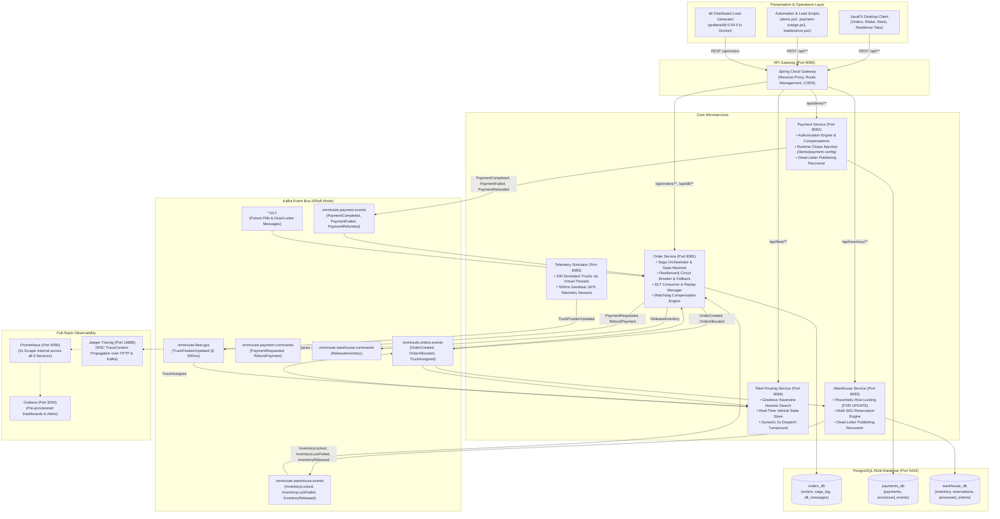
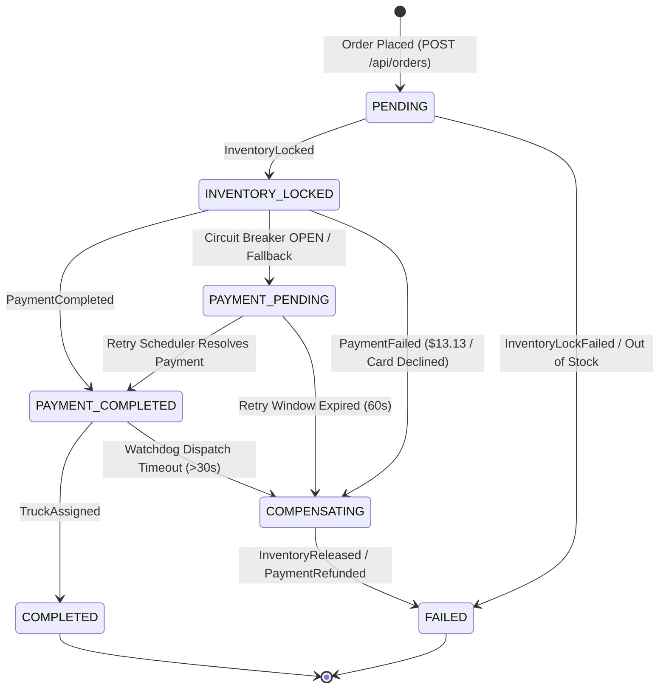

# OmniRoute: Event-Driven Distributed Order Fulfillment & Fleet Routing

OmniRoute is an enterprise-grade, event-driven distributed logistics and order fulfillment platform built with **Java 21**, **Spring Boot 3.3**, **Apache Kafka (KRaft)**, **PostgreSQL 16**, **Resilience4j**, **OpenTelemetry / Jaeger / Prometheus / Grafana**, and a real-time **JavaFX 21** desktop control center.

It coordinates distributed transactions via the **Saga Pattern (Orchestrator-driven)**, incorporates automated compensations, watchdog fail-safes, non-fatal circuit-breaking, Dead-Letter Topics (DLT), and dynamic vehicle routing using real-time GPS telemetry and Haversine geodesic algorithms.

---

## 1. System Architecture



---

## 2. Ports & Endpoints Reference

| Service | Port | Key Endpoints / Features |
|---|---|---|
| **API Gateway** | `8080` | `http://localhost:8080/api/**`<br>`/api/orders`, `/api/inventory`, `/api/fleet/**`, `/api/demo/**`, `/api/dlt/**` |
| **Order Service** | `8081` | `http://localhost:8081/orders`<br>`/orders/circuit-breaker`, `/dlt/messages`, `/dlt/replay/{id}` |
| **Payment Service** | `8082` | `http://localhost:8082/actuator/health`<br>`POST /demo/payment-config` (runtime fault injection) |
| **Warehouse Service** | `8083` | `http://localhost:8083/inventory`<br>Pessimistic stock locking & reservation management |
| **Fleet Routing** | `8084` | `http://localhost:8084/fleet/trucks`<br>`/fleet/trucks/assignments` (live GPS tracking & dispatch) |
| **Telemetry Simulator**| `8085` | `http://localhost:8085/actuator/health`<br>200 simulated trucks broadcasting GPS telemetry every 500ms |
| **Kafka UI** | `8090` | `http://localhost:8090`<br>Visual Kafka topic browser, consumer groups, message inspector |
| **Prometheus** | `9090` | `http://localhost:9090`<br>Metrics collection engine (2-second scrape interval) |
| **Grafana** | `3000` | `http://localhost:3000` (`admin` / `admin`)<br>Pre-provisioned dashboards for throughput, lag, CB state |
| **Jaeger Tracing** | `16686` | `http://localhost:16686`<br>Distributed tracing UI (OTLP gRPC :4317, OTLP HTTP :4318) |
| **PostgreSQL 16** | `5432` | `postgres:postgrespassword`<br>Databases: `orders_db`, `payments_db`, `warehouse_db` |
| **Kafka (KRaft)** | `29092` | `localhost:29092` (host) / `kafka:9092` (internal Docker network) |

---

## 3. Distributed Saga Flows & State Machine

OmniRoute implements an Orchestrator-driven Saga pattern in `order-service` with comprehensive state validation:

### A. Order State Machine



### B. Happy Path Sequence
1. Customer submits `POST /api/orders`. Order created with status `PENDING`.
2. `order-service` publishes `OrderCreated` to `omniroute.orders.events`.
3. `warehouse-service` acquires pessimistic row lock (`SELECT ... FOR UPDATE`), decrements stock, creates `ACTIVE` reservation, and publishes `InventoryLocked`.
4. `order-service` transitions order to `INVENTORY_LOCKED` and calls `publishPaymentRequested` (guarded by Resilience4j Circuit Breaker).
5. `payment-service` authorizes the transaction and publishes `PaymentCompleted`.
6. `order-service` transitions order to `PAYMENT_COMPLETED` and publishes `OrderAllocated`.
7. `fleet-routing` finds nearest available truck via Haversine distance, marks truck busy, and publishes `TruckAssigned`.
8. `order-service` transitions order to `COMPLETED`.

### C. Compensation Sequence (Deterministic $13.13 Rule & Failures)
1. Any order with total `$13.13` (or random failure) triggers deterministic card decline in `PaymentService`.
2. `payment-service` publishes `PaymentFailed(reason: "Card declined...")`.
3. `order-service` transitions order to `COMPENSATING` and dispatches `ReleaseInventory` command.
4. `warehouse-service` restores stock (`available_qty += qty`), marks reservation `RELEASED`, and publishes `InventoryReleased`.
5. `order-service` transitions order to `FAILED` with failure reason recorded in audit log. Stock invariant is perfectly preserved.

---

## 4. Resilience Architecture & Chaos Engineering

### A. Non-Fatal Circuit Breaking & Graceful Degradation
- **Resilience4j Circuit Breaker**: Configured on the payment path (`paymentService`).
  - Sliding Window: 5 calls, Minimum: 3 calls.
  - Failure Rate Threshold: 50%.
  - Slow Call Threshold: 50% for calls exceeding 2000ms.
  - Open State Wait Duration: 5000ms.
- **`PAYMENT_PENDING` State**: When the circuit trips or payment service becomes unreachable, orders do not abort. Instead, they gracefully transition to `PAYMENT_PENDING` with inventory safely held.
- **Self-Healing Retry Scheduler**: `PaymentPendingRetryScheduler` runs periodically, probes circuit health, and re-dispatches payment requests once the circuit enters `HALF_OPEN` or `CLOSED`.

### B. Dead-Letter Topics (DLT) & Poison Pill Replay
- Every Kafka listener in all 4 backend services is protected by a Spring `DefaultErrorHandler` backed by `DeadLetterPublishingRecoverer` and `ExponentialBackOffWithMaxRetries(3)`.
- Fatal non-retryable deserialization errors or poison pills are automatically diverted to `<topic>.DLT` without stalling consumer groups.
- `order-service` consumes DLT events into `dlt_messages` table and exposes:
  - `GET /dlt/messages` (inspect dead-letter queue)
  - `POST /dlt/replay/{id}` (republish message to original topic for reprocessing)

### C. Automated Chaos Outage Test
OmniRoute includes an automated chaos script simulating a complete payment service outage:
```powershell
powershell -ExecutionPolicy Bypass -File scripts/chaos/payment-outage.ps1
```
The test:
1. Places a baseline order -> verifies `COMPLETED`.
2. Stops `omniroute-payment-service` container.
3. Places 4 orders during outage -> verifies fast acceptance (< 70ms), circuit breaker `OPEN`, and all orders queued in `PAYMENT_PENDING`.
4. Restarts `omniroute-payment-service`.
5. Verifies all 4 queued orders automatically complete without manual intervention.

---

## 5. Performance & Load Test Results

OmniRoute was benchmarked using a 50-VU, 60-second sustained load test driving an 85/15 workload mix (85% normal orders, 15% forced-failure orders) with pinned k6 (`grafana/k6:0.54.0`):

| Metric | Target SLA | Measured Result |
|---|---|---|
| **Total Orders Dispatched** | > 2,000 | **3,697 orders** |
| **HTTP Submission Throughput** | > 30 req/s | **65.26 req/sec** |
| **HTTP Success Rate (202 Accepted)** | > 99% | **100.00%** (0 errors) |
| **HTTP Latency (p50)** | < 50 ms | **11.58 ms** |
| **HTTP Latency (p95)** | < 200 ms | **25.03 ms** |
| **HTTP Latency (p99)** | < 500 ms | **236.50 ms** |
| **Completed Orders (Happy Path)** | ~85% | **3,103 orders (83.93%)** |
| **Failed / Compensated Orders** | ~15% | **594 orders (16.07%)** |
| **Saga Settlement Time** | < 60s | **26.0 seconds** (all 3,697 settled) |
| **Stock Invariant Verification** | 100% | **10/10 SKUs CONSISTENT (0 leaks)** |

Full report and bottleneck analysis are documented in [docs/performance.md](docs/performance.md).

To run the load test:
```powershell
powershell -ExecutionPolicy Bypass -File loadtest/run.ps1
```

---

## 6. JavaFX Desktop Control Center

The desktop client provides a real-time operations console built in JavaFX 21:

```powershell
mvn -pl desktop-client javafx:run
```

### Application Tabs:
1. **📦 Orders & Sagas**:
   - Order placement form with live item selection.
   - Real-time orders table with status badges (`PENDING`, `INVENTORY_LOCKED`, `PAYMENT_COMPLETED`, `COMPLETED`, `FAILED`).
   - Detailed Saga audit trail showing millisecond-accurate timeline of every distributed event.
2. **🚚 Live Fleet Radar**:
   - 60 FPS Canvas radar tracking 200 autonomous vehicles moving in real-time.
   - Dynamic geodesic dispatch lines linking assigned trucks to warehouse hubs.
3. **🏭 Warehouse Inventory**:
   - Live SKU availability cards and capacity bars across all 10 catalog items.
4. **⚡ Resilience & Chaos Engineering**:
   - **Simulated Payment Latency Slider** (0 ms to 5000 ms).
   - **Payment Failure Rate Slider** (0% to 100%).
   - **Live Circuit Breaker Pill Badge**: Real-time polling showing `● CLOSED` (green), `● OPEN` (red), or `● HALF_OPEN` (amber).
   - **One-Click Actions**: "Apply Chaos Config", "Reset to Defaults (0ms, 0%)", and "Trip Circuit Breaker (100% Fail)".

---

## 7. How to Run & Verify

### A. Start Backend Services
```powershell
cd omniroute
docker compose up --build -d
```

### B. Run End-to-End Regression Gate
Verifies gateway health, happy path order, forced $13.13 failure compensation, and a 20-order consistency burst:
```powershell
powershell -ExecutionPolicy Bypass -File scripts/regression-gate.ps1
```

### C. Run 100-Order Consistency Demo
Dispatches 100 orders with a randomized 10% payment failure mix and verifies mathematical stock invariant consistency:
```powershell
powershell -ExecutionPolicy Bypass -File scripts/demo.ps1
```

### D. Run Chaos Payment Outage Test
```powershell
powershell -ExecutionPolicy Bypass -File scripts/chaos/payment-outage.ps1
```

### E. Run Full 50-VU k6 Load Test
```powershell
powershell -ExecutionPolicy Bypass -File loadtest/run.ps1
```

---

## 8. Future Work & Production Roadmap

While OmniRoute implements a complete, self-healing distributed architecture, the following enhancements represent the production evolution roadmap:

### 1. Kafka Streams Materialized State Stores
- **Current State**: Fleet positions and nearest-vehicle assignments reside in memory with periodic GPS broadcast.
- **Evolution**: Replace in-memory structures with **Kafka Streams RocksDB-backed state stores** (`KTable`, `GlobalKTable`) partitioned by geographic quad-tree tiles (geohashes). Enable interactive queries (`IQ`) across multiple fleet-routing instances for scalable spatial querying.

### 2. Event Sourcing & CQRS (Axon / Eventuate)
- **Current State**: Order state machine updates relational state in PostgreSQL and logs steps to `saga_log`.
- **Evolution**: Full **Event Sourcing** where the order entity is represented purely as an append-only sequence of immutable domain events (`OrderInitiated`, `InventoryReservationConfirmed`, `PaymentCaptured`, `VehicleDispatched`). Projections populate optimized CQRS read models for real-time analytics.

### 3. Dynamic Vehicle Routing Problem (VRP) Optimization
- **Current State**: Point-to-point Haversine geodesic distance calculation.
- **Evolution**: Integrate **Timefold / OptaPlanner** alongside an OpenStreetMap routing engine (OSRM or GraphHopper). Solve multi-stop Vehicle Routing Problems with Time Windows (VRPTW), driver hours-of-service constraints, vehicle payload limits, and live traffic congestion feeds.

### 4. Cloud-Native Kubernetes & Istio Service Mesh
- **Current State**: Docker Compose deployment with internal bridge networking.
- **Evolution**: Package services into **Helm charts** for deployment on Kubernetes (EKS/GKE). Introduce **Istio Service Mesh** for transparent mutual TLS (mTLS), canary traffic shifting, and Prometheus-driven Horizontal Pod Autoscaling (HPA) pegged to Kafka consumer group lag.

### 5. Multi-Region Active-Active Database Replication
- **Current State**: Single PostgreSQL 16 cluster with isolated databases.
- **Evolution**: Migrate to a distributed SQL engine (**CockroachDB** or **YugabyteDB**) supporting raft-consensus geo-replication across cloud availability zones. Pair with **Kafka MirrorMaker 2.0** for active-active event fabric replication with zero-data-loss failover.
